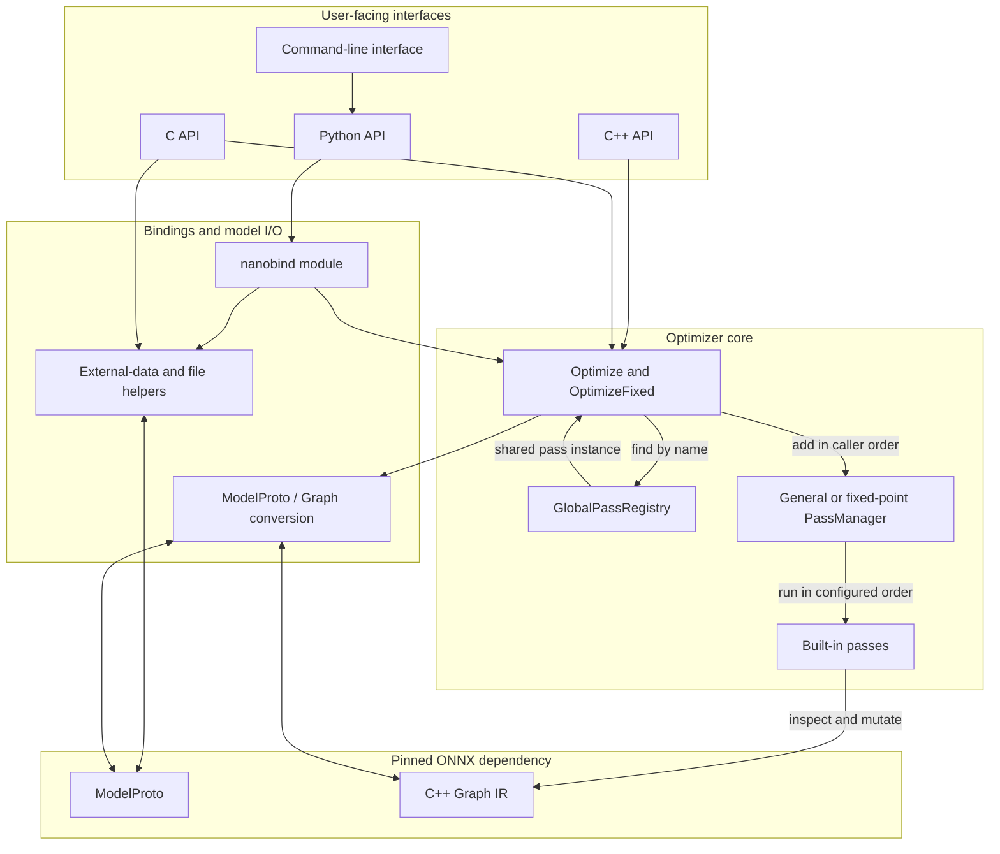
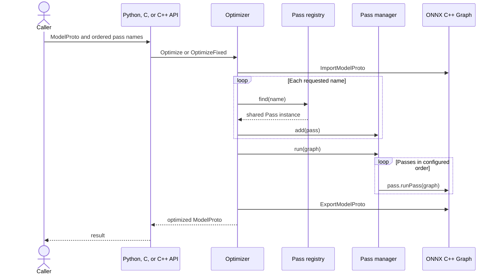
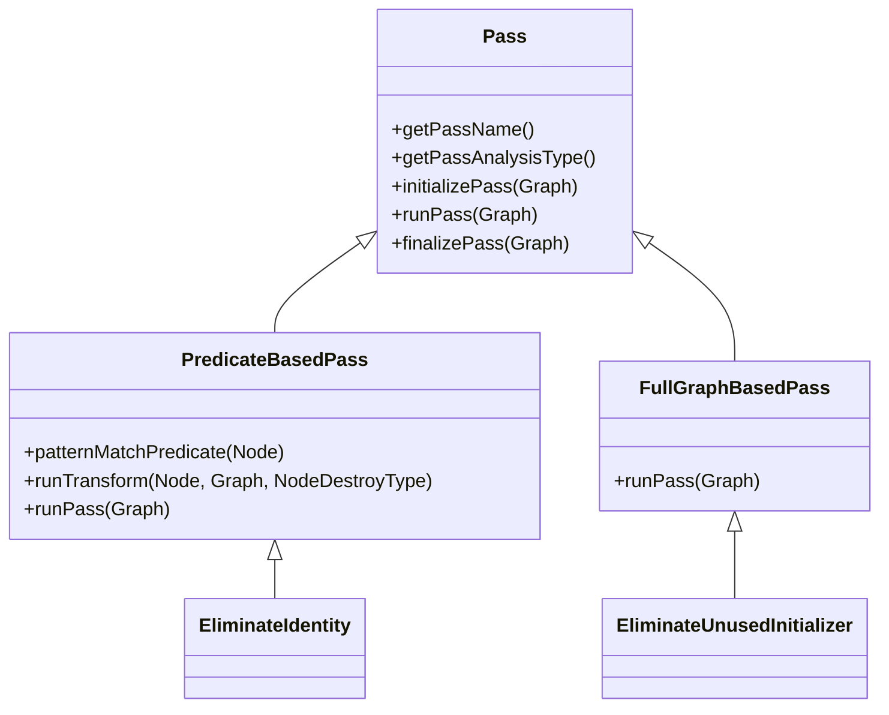
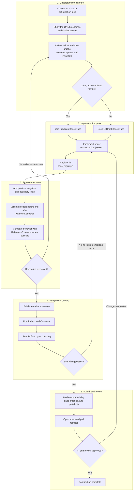

<!--
SPDX-FileCopyrightText: ONNX Project Contributors

SPDX-License-Identifier: Apache-2.0
-->

# Optimizer internals and contributing a pass

This guide explains how `onnxoptimizer` turns a list of pass names into graph
rewrites and how to make a first change safely. It is intended as a map of the
codebase, not as a replacement for the ONNX operator specifications or the
ONNX intermediate-representation (IR) documentation.

## Mental model

The optimizer does not execute a model and it does not choose passes
automatically based on a target backend. A caller supplies an ordered list of
named passes. Each pass inspects and possibly mutates the ONNX C++ IR while
preserving the observable behavior and public interface of the model.

The C++ API can also optimize an existing `Graph` in place through
`OptimizeGraph` or `OptimizeGraphFixed`, avoiding the `ModelProto` round trip.
The command-line interface loads a model, invokes the same Python API, runs
shape inference by default, and saves the result.

For models that cannot be serialized into one protobuf byte string, the Python
wrapper falls back to temporary model and external-data files. Model-local
function definitions are currently copied to the output model; their bodies
are not optimized.

## Architectural building blocks

The codebase is easiest to understand as four layers. Interfaces accept models
and pass names, adapters cross language and storage boundaries, the optimizer
core schedules work, and passes mutate the graph representation supplied by
the pinned ONNX dependency.



The boundaries have distinct responsibilities:

- **Interfaces** decide how callers provide a model and an ordered pass list.
- **Bindings and model I/O** serialize models, bridge Python to C++, and handle
  models stored with external tensor data.
- **Optimizer core** resolves pass names and selects one-shot or fixed-point
  scheduling. It does not contain individual rewrite rules.
- **Passes and ONNX IR** contain the graph-specific logic. Passes work on
  `Graph`, `Node`, and `Value`, not directly on protobuf node records.

### Model-processing flow

For the proto-based entry points, one optimization request follows this
sequence:



`OptimizeGraph` and `OptimizeGraphFixed` enter at the pass-manager step and
mutate an existing `Graph`; their callers own proto-level concerns such as IR
version handling and copying model-local functions.

### Pass framework

The pass hierarchy separates the scheduling contract from the two common
rewrite styles:



The registry owns shared pass instances. An `Optimizer` looks them up by name,
adds them to a manager in the caller's order, and asks the manager to run them
against one graph. This makes the registry, manager, and pass class the three
main extension points to inspect when changing execution behavior.

## Repository map

| Path | Purpose |
| --- | --- |
| `onnxoptimizer/pass.h` | Pass metadata, base classes, traversal, and rewrite helpers |
| `onnxoptimizer/pass_manager.*` | Ordered, one-shot and fixed-point pass execution |
| `onnxoptimizer/pass_registry.*` | Built-in pass registration and name lookup |
| `onnxoptimizer/optimize.*` | Public C++ entry points and proto/IR conversion |
| `onnxoptimizer/passes/` | Individual optimization passes and shared pass utilities |
| `onnxoptimizer/cpp2py_export.cc` | Native Python bindings |
| `onnxoptimizer/c_api/` | Serialized-model and file-based C interface |
| `onnxoptimizer/onnxoptimizer_main.py` | Command-line interface |
| `onnxoptimizer/test/` | Python correctness and regression tests |
| `tests/` | C++ API tests |
| `third_party/onnx/` | Pinned ONNX submodule that provides the C++ IR |

Most passes are implemented in headers under `onnxoptimizer/passes/`. CMake
collects both `.h` and `.cc` files from that directory, so a pass can be split
into a source file when that makes the implementation clearer.

## Pass types

Every pass derives from `Pass` and declares three pieces of metadata:

- `PassType` describes the kind of rewrite, such as `Fuse`, `Nop`, or
  `Replace`. It also determines whether the pass appears in the default Python
  list returned by `get_fuse_and_elimination_passes()`.
- `PassEfficiency` describes fixed-point behavior. `Complete` means one run is
  sufficient. `Partial` means another run may expose more matches.
- `PassOptimizationType` records the intended benefit, such as `Compute` or
  `Memory`.

There are two commonly used implementation styles.

### `PredicateBasedPass`

Use this for a local rewrite centered on a node. Implement:

- `getPassName()` with a unique, stable name;
- `patternMatchPredicate()` to recognize a safe candidate; and
- `runTransform()` to perform the mutation.

The base class walks nodes in the graph and recursively visits graph-valued
node attributes, such as the bodies of `If`, `Loop`, and `Scan`. It also calls
the optional `initializePass()` and `finalizePass()` hooks once per `runPass()`.

`runTransform()` must return `true` when it performed a counted rewrite. If the
current node should be removed, set `destroy_current` to `DestroyOne`; do not
delete the iterator's current node directly. The traversal removes it safely
after the callback returns.

[`eliminate_identity.h`](../onnxoptimizer/passes/eliminate_identity.h) is the
smallest example. It replaces uses of an `Identity` output with its input and
then asks the traversal to destroy the node.

### `FullGraphBasedPass`

Use this when the rewrite needs graph-wide state or a custom traversal. The
pass implements `runPass(Graph&)` itself and is responsible for descending
into nested graphs when the transformation should apply there.

[`eliminate_unused_initializer.h`](../onnxoptimizer/passes/eliminate_unused_initializer.h)
is a compact example. It first computes the set of referenced initializers and
then removes the remainder.

## Registration and execution

Adding a class under `onnxoptimizer/passes/` is not enough to expose it. Include
the pass header in `pass_registry.h` and add a `registerPass<YourPass>()` call
to `GlobalPassRegistry`.

Registration order is observable: it defines the order returned by
`get_available_passes()` and, for fuse/elimination passes, the default order
used by the Python API and command-line interface. Explicit pass lists always
run in the order supplied by the caller. Consider interactions with adjacent
passes before choosing a registration position.

`GeneralPassManager` runs the configured sequence once. `FixedPointPassManager`
uses each pass's analysis result and repeats a `Partial` pass while it continues
to report successful rewrites; it may then run the configured sequence again.
A pass marked `Complete` must therefore reach its own fixed point in one run.

## Adding a pass

An optimizer contribution starts with a semantic contract, not with C++ code.
Use the following workflow to turn an optimization idea into a reviewable
change:



Start by reading two or three passes with a similar graph pattern. In
particular, check whether they guard on the opset, constant inputs, graph
outputs, multiple consumers, and missing shape information.

## Correctness checklist

Graph rewrites can produce a valid-looking model with different behavior. Test
the contract, not only the resulting node count.

- Preserve graph input and output names. `tryReplacingAllUsesWith()` deliberately
  refuses some replacements where both values are part of the graph interface.
- Account for multiple consumers. Removing or modifying a producer is unsafe if
  another branch still relies on its original value.
- Check the operator domain as well as its name when a rewrite only applies to
  standard ONNX operators.
- Respect opset-specific schemas. Inputs, attributes, defaults, and semantics
  can change between operator versions.
- Treat omitted optional inputs, empty-string placeholders, and optional
  outputs as distinct cases where the schema does.
- Do not assume inferred shapes or constant values are available. Make those
  requirements explicit in the match predicate and add a negative test.
- Cover nested subgraphs if the pass should apply inside control-flow
  operators. Predicate-based traversal handles graph attributes; custom
  full-graph passes must do so explicitly.
- Preserve value types and shapes when creating or reconnecting values.
- Keep the graph topologically valid and use the traversal's destruction
  protocol for the current node.
- Check pass ordering and idempotence. Use `Partial` only when repeated
  application can make additional progress, and ensure every successful
  rewrite moves toward termination.

## Testing a rewrite

A strong regression test usually contains:

1. the smallest graph that should match;
2. nearby graphs that must not match;
3. `onnx.checker.check_model()` before and after optimization;
4. an assertion about the rewritten structure; and
5. a numerical or exact output comparison when the operators can be evaluated
   by `onnx.reference.ReferenceEvaluator`.

Also add cases for every relevant opset boundary, graph outputs, shared values,
and nested graphs. The focused Dropout tests in
[`eliminate_nop_dropout_test.py`](../onnxoptimizer/test/eliminate_nop_dropout_test.py)
show this style: they validate the model, cover optional-output use patterns,
and compare outputs through the reference evaluator.

## Build and checks

Clone with submodules, because the native build uses the pinned ONNX checkout:

```bash
git clone --recursive https://github.com/onnx/optimizer.git onnxoptimizer
cd onnxoptimizer
```

For Python development:

```bash
python -m pip install -e .
python -m pip install pytest pytest-xdist ruff mypy
python -m pytest onnxoptimizer/test
ruff check .
python setup.py typecheck
```

Native changes require rebuilding the extension. For the standalone C++ build
and tests, use the same shape as CI:

```bash
cmake -GNinja -DONNX_BUILD_TESTS=ON -B build -S .
cmake --build build
ctest --test-dir build --output-on-failure
```

Keep Linux, macOS, and Windows in mind. Avoid platform-specific filesystem,
compiler, or integer-width assumptions, and let CMake express platform
differences where possible.

## Suggested first exploration

Run one small pass explicitly and inspect the graph before and after:

```python
import onnx
from onnx import TensorProto, helper
import onnxoptimizer

graph = helper.make_graph(
    [helper.make_node("Identity", ["X"], ["Y"])],
    "identity_graph",
    [helper.make_tensor_value_info("X", TensorProto.FLOAT, [2, 3])],
    [helper.make_tensor_value_info("Y", TensorProto.FLOAT, [2, 3])],
)
model = helper.make_model(graph)

optimized = onnxoptimizer.optimize(model, ["eliminate_identity"])
onnx.checker.check_model(optimized)
print(onnx.helper.printable_graph(optimized.graph))
```

Then trace that call through `__init__.py`, `cpp2py_export.cc`, `optimize.cc`,
the registry, the pass manager, and `eliminate_identity.h`. That path contains
the main extension points used by nearly every optimizer contribution.
